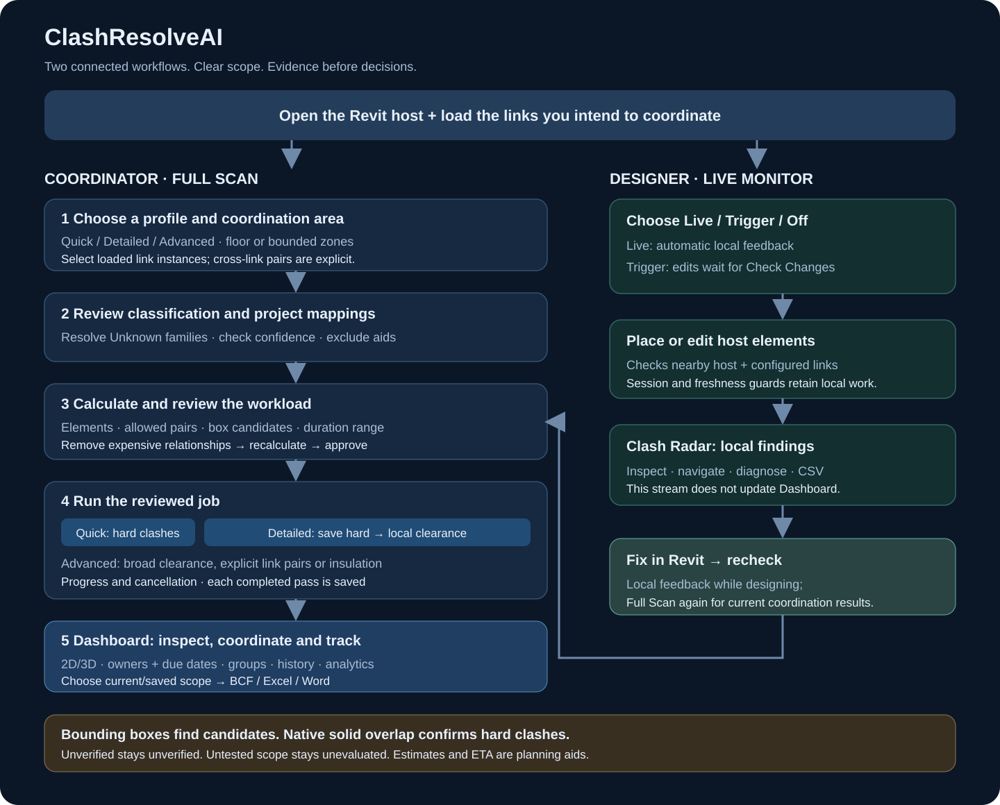
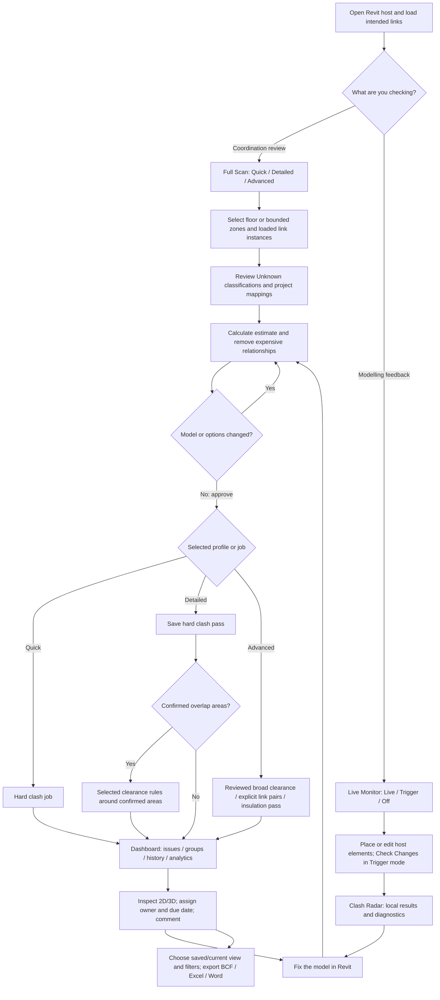

# Using ClashResolveAI

## Choose the right workflow

| What you need | Start here | Scope and output |
|---|---|---|
| Routine floor coordination | Full Scan → Quick | Hard clashes; host and selected loaded links → Dashboard |
| Clearance near confirmed coordination areas | Full Scan → Detailed | Hard pass saved first; selected clearance rules around its confirmed overlap areas → separate saved scan versions |
| Broader clearance or unusual category selection | Full Scan → Advanced | Deliberate scope, disciplines/categories and selected rules → Dashboard |
| Two linked disciplines against each other | Advanced → Link ↔ link | Add only the required explicit instance pairs; separate job |
| Insulation allowance review | Advanced → Insulation clearance | Dedicated pass including insulation; owning element/insulation pairs are excluded |
| Feedback while placing or editing elements | Live Monitor → Live | Local host changes and nearby configured links → Clash Radar |
| Check edits when you decide | Live Monitor → Trigger | Edits accumulate until Check Changes |

## Read the estimate before Start

1. Confirm loaded and selected links. An unloaded link cannot be tested; its element count is unavailable.
2. Check the floor/zone and candidate disciplines. Unknown and excluded element counts explain missing candidates; use classification review for corrections.
3. Distinguish **possible source relationships** from **bounding-box candidates**. Neither is a count of confirmed physical clashes.
4. Uncheck expensive model relationships and recalculate. A changed model, mapping, rule, scope or selection invalidates the reviewed estimate.
5. Treat duration ranges and the running source-rate ETA as planning aids. Without comparable completed timing measurements the duration is unavailable. Detailed's estimate is a conservative two-pass upper bound.

## Review, fix, verify, share

In Dashboard, select the intended scan version, filters or group. Inspect the actual elements/overlap and read physical evidence before changing status. Assign ownership and due dates, record decisions, then fix the authoring model. Run the relevant Full Scan again to update coordination results. Confirmed absence resolves an issue only under reliable comparable scope; excluded or untested findings remain unevaluated.

If Detailed clearance is cancelled or fails, its completed hard pass remains saved. A cancelled pass never publishes partial findings. Link-to-link and insulation remain separate deliberate jobs. A model/link/mapping change cancels a running scan rather than publishing stale geometry.

Export the selected current/historical state to BCF, Excel or Word. Radar's CSV contains local Live results; it is a different scope. Optional AI suggestions can help draft coordination text and require a configured key; review the README's data-sharing notes before using them.

**Keep the two result streams distinct:** Live Monitor supports modelling feedback. Dashboard records Full Scan coordination. Live checks do not certify the freshness or completeness of a saved Dashboard scan.
